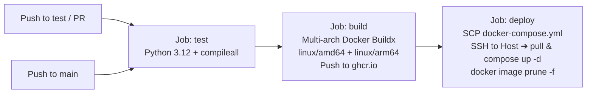

# 🎬 Shorts / TikTok / Reels Downloader Bot (shrt-tt-reels)

[](https://www.python.org/)
[](https://docs.aiogram.dev/)
[](https://www.docker.com/)
[](https://github.com/welcomeforalone/shrt-tt-reels/actions)
[](#-devsecops--security-architecture)
[](LICENSE)
[](README.ru.md)

🌐 **Language / Язык:** [🇺🇸 English](README.md) | [🇷🇺 Русская документация (README.ru.md)](README.ru.md)

---

**shrt-tt-reels** is an enterprise-grade, high-throughput asynchronous Telegram bot engineered to fetch, transcode, and deliver media from **TikTok** (watermark-free HD videos and photo carousels), **Instagram Reels**, and **YouTube Shorts**. 

Constructed with strict **DevSecOps** principles, the service features multi-tier Server-Side Request Forgery (SSRF) and DNS rebinding mitigation, automated anti-bot circumvention (YouTube Proof-of-Origin token generation coupled with Cloudflare WARP SOCKS5 tunneling), asynchronous concurrency throttling, memory-safe rate limiting, intelligent FFmpeg video compression, and full bilingual (EN/RU) localization.

---

## 📑 Table of Contents

- [Architectural Blueprint](#-architectural-blueprint)
- [Key Features](#-key-features)
  - [TikTok Backend](#1-tiktok-processing-botbackendstiktokpy)
  - [Instagram Reels Backend](#2-instagram-reels-processing-botbackendsinstagrampy)
  - [YouTube Shorts Backend](#3-youtube-shorts-processing-botbackendsyoutubepy)
  - [Intelligent Video Compression](#4-intelligent-video-compression-botutilspy)
  - [Dual-Language Localization (i18n)](#5-dual-language-localization-i18n-boti18npy)
- [DevSecOps & Security Architecture](#-devsecops--security-architecture)
- [Quick Start Guide](#-quick-start-guide)
- [Configuration Reference](#-configuration-reference)
- [CI/CD Pipeline](#-cicd-pipeline)
- [Repository Layout](#-repository-layout)
- [License](#-license)

---

## 🏗️ Architectural Blueprint

The application employs an asynchronous pipeline driven by `aiogram 3.x` and `asyncio`, enforcing defensive perimeter checks prior to routing requests through a Chain of Responsibility platform orchestrator:

```mermaid
flowchart TD
    User([Telegram User]) -->|1. Sends Link / URL| Bot[Telegram Bot Engine<br/>aiogram 3.x + asyncio]

    subgraph SecurityLayer ["1. DevSecOps & Security Layer (bot/utils.py)"]
        SSRF["SSRF & DNS Rebinding Filter<br/>Scheme check + Blocklist + socket.getaddrinfo + ipaddress"]
        RateLimit["Sliding Window Rate Limiter<br/>5 req/min per user + Memory Leak GC sweep"]
        Semaphores["Asyncio Semaphores<br/>Downloads: max 3 | Transcoding: max 2"]
    end

    Bot --> SSRF
    SSRF -->|Valid & Public URL| RateLimit
    SSRF -->|Blocked Host/IP/Scheme| RejectSSRF["Reject: unsafe_url"]
    RateLimit -->|Within Quota| Semaphores
    RateLimit -->|Exceeded Limit| RejectLimit["Reject: rate_limit"]

    subgraph RouterLayer ["2. Platform Router / Chain of Responsibility (bot/downloader.py)"]
        Semaphores --> Router{"Platform Detect<br/>(Regex Pattern)"}
        Router -->|TikTok URL| TikWM["tikwm.com API (bot/backends/tiktok.py)<br/>Watermark-free HD / Photos"]
        Router -->|Instagram URL| IGAPI["Public API Hook (bot/backends/instagram.py)"]
        Router -->|YouTube / Fallback| YTDLPRouter["yt-dlp Engine (bot/backends/youtube.py)"]
        TikWM -.->|API Fallback (if not /photo/)| YTDLPRouter
        IGAPI -.->|API Fallback| YTDLPRouter
    end

    subgraph InfraLayer ["3. Anti-Bot & Network Infrastructure (docker-compose.yml)"]
        YTDLPRouter --> CookieClone["Thread-Safe Cookie Isolation<br/>cookies.txt ➔ {uuid}_cookies.txt"]
        CookieClone --> POToken["Proof-of-Origin (PO) Token Generator<br/>bgutil-pot container (:4416) via bot_network"]
        POToken --> WARPProxy["Egress Traffic Tunneling<br/>Cloudflare WARP (socks5://warp:1080)"]
        WARPProxy -.->|Exponential Backoff Exhausted| DirectConn["Direct Egress Fallback (No Proxy)"]
    end

    subgraph MediaLayer ["4. Media Processing & Delivery (bot/handlers.py, bot/utils.py)"]
        TikWM -->|Photo Carousel| PhotoChunker["Carousel Chunker<br/>Batches of 10 for MediaGroupBuilder"]
        WARPProxy & DirectConn & TikWM -->|Video File| SizeCheck{"File Size > 45 MB?<br/>(MAX_VIDEO_SIZE_MB)"}
        SizeCheck -->|No (<= 45 MB)| Dispatcher["Telegram Delivery Dispatcher"]
        SizeCheck -->|Yes (> 45 MB)| FFmpeg["FFmpeg Transcoder<br/>libx264, veryfast, crf 28, maxrate 2M<br/>180s Timeout & SIGKILL Guard"]
        FFmpeg --> FinalCheck{"Post-Compression <= 50 MB?"}
        FinalCheck -->|Yes| Dispatcher
        FinalCheck -->|No| RejectSize["Error: Video exceeds Telegram 50 MB limit"]
        PhotoChunker --> Dispatcher
    end

    Dispatcher -->|answer_video / answer_photo / answer_media_group| TelegramAPI["Telegram Cloud API"]
    TelegramAPI --> User
    Dispatcher --> Cleanup["Guaranteed Resource Cleanup<br/>finally blocks prune temp files, chunks & cookies"]
```

---

## ✨ Key Features

### 1. TikTok Processing (`bot/backends/tiktok.py`)
- **Watermark-Free Video Extraction**: Queries `https://www.tikwm.com/api/` (`hd=1`) using an optimized, long-lived `httpx.AsyncClient` with custom browser headers.
- **Photo Carousel Support**: Detects image sets (`images` array) and downloads each slide sequentially.
- **Telegram Album Chunking**: Splices multi-photo albums into chunks of up to 10 images using `MediaGroupBuilder`, guaranteeing compliance with Telegram Bot API constraints. Single images are sent via `answer_photo`.
- **Atomic Disk Rollback**: If network transport interrupts carousel downloads, all previously written partial images (`_{index}.jpg`) are immediately unlinked in exception handlers.
- **Safe Fallback Guard**: If `tikwm.com` returns non-zero status, fallback to `yt-dlp` is skipped for URLs containing `/photo/` to prevent known parser crashes.

### 2. Instagram Reels Processing (`bot/backends/instagram.py`)
- **Extensible Chain of Responsibility**: Exposes a clean interface (`download_via_public_api`) for proprietary or third-party Instagram scrapers.
- **Automated Fallback**: Automatically cascades to `yt-dlp` routed over Cloudflare WARP residential-range IP addresses.

### 3. YouTube Shorts Processing (`bot/backends/youtube.py`)
- **YouTube Bot Bypass (PO Token)**: Integrates `bgutil-ytdlp-pot-provider` plugin pointing to a dedicated container (`http://bgutil-pot:4416`), acquiring cryptographic Proof-of-Origin visitor tokens to bypass bot challenges.
- **Cloudflare WARP Tunneling**: Routes YouTube video downloads through an internal SOCKS5 proxy (`socks5://warp:1080`), bypassing IP-reputation bans and regional blocks.
- **Thread-Safe Cookie Isolation**: Clones `/home/botuser/app/cookies.txt` into an isolated, per-download file (`{base_path}_cookies.txt`). This prevents race conditions and file lock collisions when concurrent worker coroutines execute `yt-dlp`.
- **Exponential Backoff & Direct Fallback**: Performs retry attempts with exponential delay (`2 ** attempt` seconds) over the proxy. If SOCKS5 tunnel fails consecutively, it executes a direct fallback download without a proxy as a final resort.
- **Partial File Purge**: Glob-based cleanup removes all temporary artifacts (`{base_path}.*`, `.part`, `.ytdl`) upon completion or failure.

### 4. Intelligent Video Compression (`bot/utils.py`)
- **Adaptive Size Detection**: Automatically checks file size against `MAX_VIDEO_SIZE_MB` (default: 45 MB). Files exceeding this threshold are routed to FFmpeg.
- **High-Efficiency Transcoding**:
  ```bash
  ffmpeg -y -i <input> -vcodec libx264 -preset veryfast -crf 28 -maxrate 2M -bufsize 4M -vf scale=-2:'min(1280,ih)' -stats -acodec copy <output>
  ```
  - Constrains resolution to max 720p/1080p (`scale=-2:'min(1280,ih)'`) while preserving aspect ratio.
  - Fixes maximum bitrate at 2 Mbps with a 4 MB buffer to strictly guarantee that output fits under Telegram's 50 MB threshold.
  - Copies audio streams verbatim (`-acodec copy`) to conserve CPU cycles.
- **Watchdog Timeout Guard**: Wraps execution in `asyncio.wait_for(..., timeout=180)`. If transcoding exceeds 3 minutes, the subprocess is forcibly killed with `process.kill()` to protect CPU resources, and leftover partial files are deleted.

### 5. Dual-Language Localization (i18n) (`bot/i18n.py`)
- **Supported Locales**: English (`en`) and Russian (`ru`).
- **Seamless Switching**: Users can change language anytime via `/lang`, `/language`, or directly in the `/start` menu using inline buttons (`InlineKeyboardMarkup`).
- **Smart Locale Auto-Detection**: Inspects `user.language_code`; telegram users with `ru`, `be` (Belarusian), or `uk` (Ukrainian) locales are automatically routed to Russian.
- **Atomic File Persistence**: Saves preferences to `data/user_langs.json` using an atomic write-replace pattern (`data/user_langs.json.tmp` ➔ `os.replace`), preventing JSON corruption during sudden container shutdowns.
- For Russian documentation, see [README.ru.md](README.ru.md).

---

## 🛡️ DevSecOps & Security Architecture

Security is baked into the foundation of the repository to prevent abuse, resource exhaustion, and lateral network traversal:

| Security Vector | Implementation Detail | Location |
| :--- | :--- | :--- |
| **SSRF Prevention** | Only `http` and `https` schemes permitted. Validates parsed hostname against a blocklist of Docker service aliases (`localhost`, `warp`, `warp_proxy`, `bgutil-pot`, `bgutil_pot`, `bot`, `tiktok_downloader_bot`) and internal TLDs (`.local`, `.internal`, `.localhost`, `.lan`). | `bot/utils.py` |
| **DNS Rebinding Guard** | Executes `socket.getaddrinfo(hostname, None)` and validates every resolved IP address using Python's `ipaddress` module. Explicitly rejects private (`RFC 1918`), loopback (`127.0.0.0/8`), link-local (`169.254.0.0/16`), multicast, reserved, and unspecified IPs. | `bot/utils.py` |
| **Zero Host Exposure** | The `warp` proxy container and `bgutil-pot` service publish **no ports to the host OS**. They communicate exclusively across the internal Docker bridge network (`bot_network`). | `docker-compose.yml` |
| **Least Privilege Execution** | Container drops `root` rights and runs strictly as an unprivileged user `botuser` (UID 1000) with a restricted home directory. | `Dockerfile` |
| **Concurrency Throttling** | Heavy async operations are gated by `asyncio.Semaphore`: limits parallel downloads (`MAX_CONCURRENT_DOWNLOADS=3`) and CPU-intensive FFmpeg encodings (`MAX_CONCURRENT_COMPRESSIONS=2`). | `bot/utils.py` |
| **Memory-Safe Rate Limiter** | Sliding window rate limiter (default: 5 requests/min per user). Prunes stale entries and performs a dictionary garbage-collection sweep whenever active tracking entries exceed 500. | `bot/utils.py` |
| **Disk Exhaustion Defense** | `yt-dlp` enforces `'max_filesize': 150MB` to prevent malicious or accidental downloads of multi-gigabyte streams. Temporary files are pruned inside `finally` blocks. | `bot/backends/youtube.py` |
| **Graceful Session Teardown** | Signals (`SIGINT`, `SIGTERM`) cleanly close `bot.session` and shutdown long-lived `httpx.AsyncClient` connection pools. | `bot/main.py` |

---

## 🚀 Quick Start Guide

### Prerequisites
- Host machine running Linux, macOS, or Windows with **Docker** and **Docker Compose v2+** installed.
- Telegram Bot Token obtained from [@BotFather](https://t.me/BotFather).

### Step-by-Step Installation

#### 1. Clone the Repository
```bash
git clone https://github.com/welcomeforalone/shrt-tt-reels.git
cd shrt-tt-reels
```

#### 2. Configure Environment Variables
Create your local environment file from the provided template:
```bash
cp .env.example .env
```
Edit `.env` and set your Telegram Bot token:
```ini
BOT_TOKEN=1234567890:AAH_your_telegram_bot_token_here
WARP_PROXY_URL=socks5://warp:1080
MAX_VIDEO_SIZE_MB=45
RATE_LIMIT_PER_MINUTE=5
MAX_CONCURRENT_DOWNLOADS=3
MAX_CONCURRENT_COMPRESSIONS=2
USER_LANGS_PATH=data/user_langs.json
```

#### 3. Initialize Cookies File
To avoid Docker volume mounting errors and enable authenticated YouTube downloading:
```bash
touch cookies.txt
```
> [!TIP]
> If YouTube enforces strict bot verification, export cookies from your web browser in Netscape format and paste them into `cookies.txt`.

#### 4. Launch Services
Spin up the multi-container stack in detached mode:
```bash
docker compose up -d --build
```

#### 5. Verify Operation
Inspect container logs to verify that the bot, Cloudflare WARP, and PO token generator initialized correctly:
```bash
docker compose logs -f bot
```

---

## ⚙️ Configuration Reference

All settings are managed via `bot/config.py` using `pydantic-settings` and can be overridden via `.env`:

| Parameter | Type | Default Value | Description |
| :--- | :---: | :---: | :--- |
| `BOT_TOKEN` | `str` | `""` (*Required*) | Telegram Bot API token issued by `@BotFather`. |
| `WARP_PROXY_URL` | `str` | `socks5://warp:1080` | SOCKS5 proxy endpoint provided by the WARP service container. |
| `MAX_VIDEO_SIZE_MB` | `int` | `45` | File size limit in megabytes; videos above this trigger FFmpeg transcoding. |
| `RATE_LIMIT_PER_MINUTE` | `int` | `5` | Maximum download requests allowed per individual user per minute. |
| `MAX_CONCURRENT_DOWNLOADS` | `int` | `3` | Maximum simultaneous download operations across all users (`asyncio.Semaphore`). |
| `MAX_CONCURRENT_COMPRESSIONS` | `int` | `2` | Maximum concurrent FFmpeg encoding jobs across the entire instance. |
| `USER_LANGS_PATH` | `str` | `data/user_langs.json` | Filesystem path for atomic persistence of user language preferences. |

---

## 🔄 CI/CD Pipeline

The project features a continuous integration and deployment pipeline configured in `.github/workflows/deploy.yml`:



### Pipeline Workflow Details:
1. **Testing Stage (`test`)**:
   - Executes on pushes to `main`, `test`, and pull requests targeting `main`.
   - Sets up Python 3.12 environment with cached dependencies.
   - Runs `python -m compileall bot` to detect syntax defects, broken imports, and typing regressions.
2. **Container Build Stage (`build`)**:
   - Triggers exclusively on pushes to `main` upon successful testing.
   - Employs Docker Buildx and QEMU to cross-compile multi-architecture images for `linux/amd64` and `linux/arm64`.
   - Authenticates and publishes tagged images (`latest` and `${{ github.sha }}`) to GitHub Container Registry (`ghcr.io/welcomeforalone/shrt-tt-reels`).
3. **Automated Production Deployment (`deploy`)**:
   - Copies `docker-compose.yml` to the production server via `appleboy/scp-action`.
   - Connects over SSH via `appleboy/ssh-action`, logs into `ghcr.io`, pulls the updated image, executes `docker compose up -d`, and prunes dangling images with `docker image prune -f`.
   - Concurrency is pinned (`group: deploy`, `cancel-in-progress: false`) to prevent race conditions during updates.

---

## 📂 Repository Layout

```
shrt-tt-reels/
├── .github/
│   └── workflows/
│       └── deploy.yml          # GitHub Actions CI/CD pipeline
├── bot/
│   ├── backends/
│   │   ├── instagram.py        # Instagram download backend & fallback hook
│   │   ├── tiktok.py           # tikwm.com client, carousel parser & cleanup
│   │   └── youtube.py          # yt-dlp backend, PO token integration & cookie isolation
│   ├── config.py               # Pydantic Settings application configuration
│   ├── downloader.py           # Platform router & Chain of Responsibility orchestrator
│   ├── handlers.py             # Aiogram 3 message, command & callback routers
│   ├── i18n.py                 # Bilingual translation engine & atomic disk storage
│   ├── main.py                 # Bot initialization, polling loop & graceful shutdown
│   └── utils.py                # SSRF guard, rate limiter, semaphores & FFmpeg compressor
├── data/                       # Volume-mounted persistent data directory
│   └── user_langs.json         # User language selections
├── .dockerignore               # Container build exclusions
├── .env.example                # Sample environment variables template
├── .gitignore                  # Git repository exclusion rules
├── cookies.txt                 # Optional Netscape YouTube cookie file
├── docker-compose.yml          # Multi-container orchestration (bot + warp + bgutil-pot)
├── Dockerfile                  # Multi-stage hardened unprivileged Python container
├── README.md                   # English documentation (this file)
├── README.ru.md                # Russian documentation
└── requirements.txt            # Production Python package requirements
```

---

## 📄 License

This software is released under the terms of the [MIT License](LICENSE).
