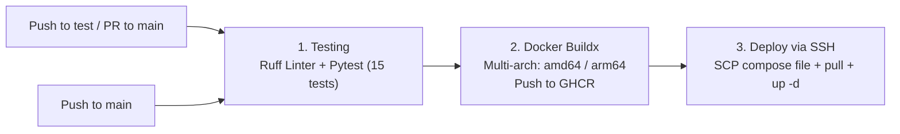

# 🎬 Shorts / TikTok / Reels Downloader Bot (shrt-tt-reels)

[](https://www.python.org/)
[](https://docs.aiogram.dev/)
[](https://www.docker.com/)
[](https://github.com/welcomeforalone/shrt-tt-reels/actions)
[](https://github.com/astral-sh/ruff)
[](https://docs.pytest.org/)
[](LICENSE)

🌐 **Language / Язык:** [🇺🇸 English](README.md) | [🇷🇺 Русская документация (README.ru.md)](README.ru.md)


## 📑 Table of Contents

- [Key Features](#-key-features)
  - [1. TikTok](#1-tiktok)
  - [2. Instagram Reels](#2-instagram-reels)
  - [3. YouTube Shorts](#3-youtube-shorts)
  - [4. Adaptive Video Compression (FFmpeg)](#4-adaptive-video-compression-ffmpeg)
  - [5. Bilingual Localization (i18n)](#5-bilingual-localization-i18n)
  - [6. Resource Limits and Security](#6-resource-limits-and-security)
- [Quick Start (Docker Compose)](#-quick-start-docker-compose)
- [Local Development & Testing](#-local-development--testing)
- [Configuration Reference (.env)](#-configuration-reference-env)
- [CI/CD Pipeline](#-cicd-pipeline)
- [Repository Structure](#-repository-structure)
- [License](#-license)


---

## ✨ Key Features

### 1. TikTok
- **Watermark-Free Video**: Queries the unofficial `tikwm.com` public API.
- **Streaming Download**: Video is streamed in 64 KB chunks with content-length validation and size limits to avoid high memory consumption.
- **Photo Carousel Albums**: Automatically splits photo carousels into albums of up to 10 images using `MediaGroupBuilder` in compliance with Telegram Bot API restrictions.
- **Fallback to yt-dlp**: If `tikwm.com` is unreachable, the bot falls back to `yt-dlp` (except for `/photo/` links, as yt-dlp does not parse TikTok photo slides).

### 2. Instagram Reels
- **yt-dlp Backend**: Instagram lacks a free, public API without Meta Graph API authentication. Reels are retrieved through `yt-dlp` routed via Cloudflare WARP.

### 3. YouTube Shorts
- **Bot Detection Bypass (PO-Tokens + WARP)**: YouTube frequently blocks data-center VPS IPs (`403` / `"Sign in to confirm you're not a bot"`). To mitigate this, `docker-compose.yml` runs a local Rust `bgutil-pot` container that generates Proof-of-Origin visitor tokens, while outbound traffic is proxied through Cloudflare WARP.
- **Duration & Resolution Constraints**: To prevent long freezes on multi-hour streams or 4K videos, `yt-dlp` enforces a duration limit (`max_youtube_duration_seconds=600`) and restricts video height to 1080p, prioritizing MP4/H.264.
- **Thread-Safe Cookie Isolation**: If a `cookies.txt` file is mounted, the bot copies it to an isolated per-download temporary file to eliminate race conditions during concurrent downloads.

### 4. Adaptive Video Compression (FFmpeg)
- The Telegram Bot API restricts bots to sending media files up to 50 MB.
- When an extracted video exceeds 45 MB, the bot invokes `ffmpeg`:
  - `ffprobe` retrieves the video's exact duration.
  - Target bitrate is computed dynamically so the compressed video fits within 46–48 MB.
  - Resolution is scaled down to a maximum of 720p/1080p (`scale=-2:'min(1280,ih)'`).
  - The process is protected by `asyncio.wait_for(..., timeout=180)`: if transcoding hangs, the subprocess is terminated and partial files are unlinked.

### 5. Bilingual Localization (i18n)
- Supports Russian (`ru`) and English (`en`).
- Automatically detects the user's client language (`ru`, `be`, `uk` -> Russian; others -> English).
- Language can be switched anytime via `/lang` or inline buttons.
- Selections are persisted atomically (`user_langs.json.tmp` -> `os.replace`) to guard against JSON corruption during container stops.

### 6. Resource Limits and Security
- **Rate Limiting**: Sliding window rate limiter (default: 5 requests/minute per user) that runs **before** any DNS or network operations.
- **Basic SSRF Check**: Enforces `http`/`https` schemes and rejects `localhost`, private subnets (`10.0.0.0/8`, `192.168.0.0/16`, `127.0.0.0/8`), and internal Docker service names (`warp`, `bgutil-pot`). Domain resolution is offloaded to a worker thread with a 3-second timeout.
- **Concurrency Throttling (`asyncio.Semaphore`)**: Restricts parallel downloads (max 3) and FFmpeg encodings (max 2) to maintain responsiveness on a small VPS.
- **Download Timeout**: Global 180s `asyncio.wait_for` timeout prevents hung downloads from holding semaphore slots indefinitely.
- **Least Privilege**: The Docker container executes as an unprivileged user `botuser` (UID 1000).

---

## 🚀 Quick Start (Docker Compose)

The recommended deployment method:

### 1. Clone the repository
```bash
git clone https://github.com/welcomeforalone/shrt-tt-reels.git
cd shrt-tt-reels
```

### 2. Configure environment
Copy the template:
```bash
cp .env.example .env
```
Add your Telegram Bot API token from [@BotFather](https://t.me/BotFather):
```ini
BOT_TOKEN=1234567890:AAH_your_telegram_bot_token_here
```

### 3. Initialize cookies file (Optional)
```bash
touch cookies.txt
```
*(If YouTube requires bot challenges, export cookies in Netscape format from your browser into this file).*

### 4. Launch containers
```bash
docker compose up -d --build
```

### 5. Inspect logs
```bash
docker compose logs -f bot
```

---

## 💻 Local Development & Testing

To run tests and debug locally without Docker:

1. **Create and activate a virtual environment:**
   ```bash
   python -m venv .venv
   # Windows:
   .venv\Scripts\activate
   # Linux/macOS:
   source .venv/bin/activate
   ```

2. **Install dependencies:**
   ```bash
   pip install -r requirements.txt
   pip install -r requirements-dev.txt
   ```

3. **Run linter and tests:**
   ```bash
   # Code check with Ruff:
   ruff check .

   # Run test suite with Pytest:
   pytest -v tests/
   ```

4. **Start the bot locally:**
   Ensure `ffmpeg` is installed on your host, then run:
   ```bash
   python -m bot.main
   ```

---

## ⚙️ Configuration Reference (.env)

| Variable | Default | Description |
| :--- | :---: | :--- |
| `BOT_TOKEN` | `""` | Telegram Bot token from [@BotFather](https://t.me/BotFather) (*required*) |
| `WARP_PROXY_URL` | `socks5://warp:1080` | Cloudflare WARP SOCKS5 proxy endpoint |
| `MAX_VIDEO_SIZE_MB` | `45` | File size threshold triggering FFmpeg compression |
| `TELEGRAM_MAX_SIZE_MB` | `50` | Maximum upload limit allowed by Telegram Bot API |
| `RATE_LIMIT_PER_MINUTE` | `5` | Request quota per user per minute |
| `MAX_CONCURRENT_DOWNLOADS` | `3` | Concurrency semaphore for media downloads |
| `MAX_CONCURRENT_COMPRESSIONS` | `2` | Concurrency semaphore for FFmpeg compression |
| `DOWNLOAD_TIMEOUT_SECONDS` | `180` | Global download timeout (`asyncio.wait_for`) |
| `MAX_TIKWM_VIDEO_SIZE_MB` | `100` | Stream size limit for TikWM downloads |
| `MAX_YOUTUBE_DURATION_SECONDS` | `600` | Duration filter rejecting videos longer than 10 minutes |
| `COOKIES_FILE_PATH` | `cookies.txt` | Path to optional YouTube cookies file |
| `USER_LANGS_PATH` | `data/user_langs.json` | Path to persistent user language preferences |

---

## 🔄 CI/CD Pipeline

Configured in `.github/workflows/deploy.yml`:



1. **Job `test`**:
   - Triggers on every push to `main` and `test`, and pull requests targeting `main`.
   - Runs `ruff check .` to enforce clean code and catch syntax or import defects.
   - Runs `pytest tests/` (15 unit tests covering SSRF checks, hostname parsing, rate limiting, and i18n).
2. **Job `build`**:
   - Triggers on push to `main` following successful tests.
   - Builds multi-architecture container images (`linux/amd64`, `linux/arm64`) using Docker Buildx and pushes to GitHub Container Registry (`ghcr.io`).
3. **Job `deploy`**:
   - Transfers `docker-compose.yml` to the production server via SCP and restarts services over SSH. External Actions are pinned to version tags (`appleboy/scp-action@v0.1.7` and `appleboy/ssh-action@v1.2.0`).

---

## 📂 Repository Structure

```
shrt-tt-reels/
├── .github/
│   └── workflows/
│       └── deploy.yml          # GitHub Actions CI/CD (Ruff + Pytest + Docker + Deploy)
├── bot/
│   ├── backends/
│   │   ├── instagram.py        # Instagram Reels backend (yt-dlp + WARP)
│   │   ├── tiktok.py           # TikTok backend (tikwm.com API: video & photos)
│   │   └── youtube.py          # YouTube backend (yt-dlp + PO-tokens + WARP + cookies)
│   ├── config.py               # Pydantic Settings configuration
│   ├── downloader.py           # Safe hostname-based platform router
│   ├── handlers.py             # aiogram 3 message, command & callback handlers
│   ├── i18n.py                 # Bilingual localization (RU/EN) and persistence
│   ├── main.py                 # Application entrypoint & graceful shutdown
│   └── utils.py                # Rate limiter, URL safety, semaphores & FFmpeg
├── tests/
│   ├── __init__.py
│   └── test_bot.py             # 15 Pytest unit tests
├── .dockerignore
├── .env.example                # Sample environment variables
├── .gitignore
├── docker-compose.yml          # Bot, Cloudflare WARP and bgutil-pot service orchestration
├── Dockerfile                  # Lightweight container on python:3.12-slim with ffmpeg and botuser
├── pyproject.toml              # Tool configurations (Ruff, Pytest)
├── README.md                   # English documentation (this file)
├── README.ru.md                # Russian documentation
├── requirements.txt            # Pinned production dependencies
└── requirements-dev.txt        # Development dependencies (Ruff, Pytest)
```

---

## 📄 License

This project is licensed under the [MIT License](LICENSE).
