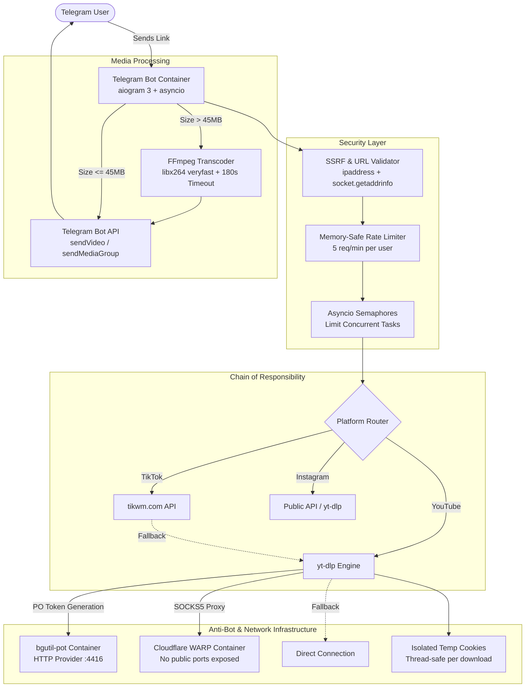

# 🎬 Shorts / TikTok / Reels Downloader Bot (`shrt-tt-reels`)

[](https://www.python.org/)
[](https://docs.aiogram.dev/)
[](https://www.docker.com/)
[](https://github.com/welcomeforalone/shrt-tt-reels/actions)
[](#-devsecops--security-hardening)
[](LICENSE)

A high-performance, resilient, and secure Telegram bot designed to download media from **TikTok** (HD videos without watermark and multi-photo carousels), **Instagram Reels**, and **YouTube Shorts**. 

Engineered with enterprise-grade DevSecOps standards, anti-bot circumvention mechanisms, asynchronous resource throttling, and dual-language localization (EN / RU).

---

## 🏗️ Architecture Overview



---

## ✨ Features

### 🎬 Media Downloading Capabilities
- **TikTok**:
  - Downloads watermark-free HD videos via `tikwm.com` with seamless fallback to `yt-dlp`.
  - Full support for **TikTok photo carousels** (including 35+ image albums, automatically chunked into Telegram-compliant media groups of 10 photos).
  - Atomic downloads: partial images are cleaned up immediately if a connection drops mid-carousel.
- **Instagram Reels**:
  - High-res video extraction with fallback chain.
- **YouTube Shorts**:
  - Advanced anti-bot bypass combining:
    - **`bgutil-ytdlp-pot-provider`**: Generates valid YouTube Proof-of-Origin (PO) tokens via a local Node.js / HTTP daemon.
    - **Cloudflare WARP**: Routes traffic through IPv4/IPv6 residential-like IP ranges to circumvent IP-based throttling.
    - **Session isolation**: Per-download temporary copy of `cookies.txt` prevents concurrency corruption.
    - **Resilient fallback**: Automatically attempts direct download if the proxy fails.

### 🗜️ Smart Video Compression
- Automatically detects if a downloaded video exceeds `45MB`.
- Compresses video using `ffmpeg` (`libx264`, `-crf 28`, `-maxrate 2M`, `-vf scale=-2:'min(1280,ih)'`).
- Hardened with an **asyncio 180-second timeout**: kills stuck FFmpeg subprocesses (`process.kill()`) and prevents CPU starvation.

### 🌐 Dual-Language Localization (i18n)
- **Supported Languages**: English (`en`) and Russian (`ru`).
- **One-Click Switch**: Interactive inline keyboard available on `/start` or via `/lang` (or `/language`).
- **Auto-Detection**: Automatically detects preferred language based on Telegram's `user.language_code`.
- **Persistent Preferences**: Stores user choices in a volume-mounted JSON file (`data/user_langs.json`) with graceful in-memory fallback.

### 🛡️ DevSecOps & Security Hardening
- **SSRF Protection**:
  - Rejects schemes other than `http` and `https`.
  - Disallows requests targeting `localhost`, `127.0.0.1`, local subnets (`10.0.0.0/8`, `172.16.0.0/12`, `192.168.0.0/16`), AWS/GCP link-local metadata endpoints (`169.254.169.254`), and internal container DNS names (`warp`, `bgutil-pot`, `bot`).
  - Resolves domain names to IP addresses via `socket.getaddrinfo` to prevent DNS rebinding attacks.
- **Zero-Exposure Proxy**:
  - The SOCKS5 `warp` proxy binds **no public ports** on the host. It is accessible exclusively by the `bot` container over an isolated internal Docker bridge network (`bot_network`).
- **Least Privilege Execution**:
  - Container runs under an unprivileged user (`botuser` with UID 1000).
- **Concurrency Throttling**:
  - `asyncio.Semaphore` restricts heavy operations (default: max 3 concurrent downloads, max 2 concurrent FFmpeg encodings).
- **Disk Overflow & Leak Protection**:
  - `yt-dlp` enforces `'max_filesize': 150MB` to avoid filling the disk with multi-hour livestreams.
  - Guaranteed temp file cleanup in `finally` blocks for videos, partial files, compressed artifacts, and photo albums.
  - Strict rules in `.gitignore` and `.dockerignore` for `cookies.txt`, `*_cookies.txt`, and user data files.
- **Graceful Shutdown**:
  - Handles `SIGINT` / `SIGTERM` by closing Telegram bot polling sessions and persistent HTTP connections cleanly.

---

## 🚀 Quick Start (Docker Compose)

### 1. Clone the Repository
```bash
git clone https://github.com/welcomeforalone/shrt-tt-reels.git
cd shrt-tt-reels
```

### 2. Configure Environment Variables
Copy `.env.example` to `.env`:
```bash
cp .env.example .env
```
Edit `.env` and insert your Telegram Bot Token obtained from [@BotFather](https://t.me/BotFather):
```env
BOT_TOKEN=1234567890:AAH_your_actual_token_here
WARP_PROXY_URL=socks5://warp:1080
MAX_VIDEO_SIZE_MB=45
RATE_LIMIT_PER_MINUTE=5
MAX_CONCURRENT_DOWNLOADS=3
MAX_CONCURRENT_COMPRESSIONS=2
USER_LANGS_PATH=data/user_langs.json
```

### 3. (Optional) Provide YouTube Cookies
For authenticated YouTube Shorts downloading and higher download limits, export your browser cookies to a Netscape format file named `cookies.txt` in the project root:
```bash
# Ensure cookies.txt exists or leave empty
touch cookies.txt
```

### 4. Build and Start Services
```bash
docker compose up -d --build
```

Check the logs to verify everything is running smoothly:
```bash
docker compose logs -f bot
```

---

## ⚙️ Configuration Reference

| Environment Variable | Default Value | Description |
|----------------------|---------------|-------------|
| `BOT_TOKEN` | *Required* | Telegram Bot API token from `@BotFather` |
| `WARP_PROXY_URL` | `socks5://warp:1080` | Internal SOCKS5 proxy endpoint for WARP container |
| `MAX_VIDEO_SIZE_MB` | `45` | File size threshold triggering FFmpeg compression |
| `RATE_LIMIT_PER_MINUTE` | `5` | Maximum download requests per user per 60 seconds |
| `MAX_CONCURRENT_DOWNLOADS` | `3` | Maximum simultaneous download operations |
| `MAX_CONCURRENT_COMPRESSIONS`| `2` | Maximum simultaneous FFmpeg transcoding processes |
| `USER_LANGS_PATH` | `data/user_langs.json` | Path to persistent user language preferences |

---

## 🔄 CI/CD Pipeline

The project includes an automated GitHub Actions workflow (`.github/workflows/deploy.yml`):
- **On `push` to `test`**: Executes Python bytecode compilation (`python -m compileall bot`) and dependency checks.
- **On `push` to `main`**:
  1. Runs tests and linters.
  2. Builds multi-architecture Docker image (`linux/amd64`, `linux/arm64`).
  3. Publishes image to GitHub Container Registry (`ghcr.io`).
  4. Deploys zero-downtime updates to the production server via SSH & Docker Compose.
- **On `pull_request`**: Runs automated tests only; production deployment steps are strictly blocked.

---

## 📄 License

This project is licensed under the [MIT License](LICENSE).
