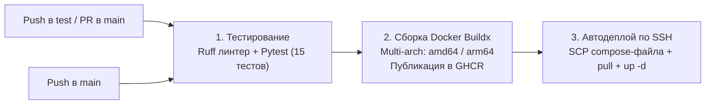

# 🎬 Shorts / TikTok / Reels Downloader Bot (shrt-tt-reels)

[](https://www.python.org/)
[](https://docs.aiogram.dev/)
[](https://www.docker.com/)
[](https://github.com/welcomeforalone/shrt-tt-reels/actions)
[](https://github.com/astral-sh/ruff)
[](https://docs.pytest.org/)
[](LICENSE)

🌐 **Язык / Language:** [🇷🇺 Русский](README.ru.md) | [🇺🇸 English Documentation (README.md)](README.md)


## 📑 Содержание

- [Основные возможности](#-основные-возможности)
  - [1. TikTok](#1-tiktok)
  - [2. Instagram Reels](#2-instagram-reels)
  - [3. YouTube Shorts](#3-youtube-shorts)
  - [4. Сжатие видео через FFmpeg](#4-сжатие-видео-через-ffmpeg)
  - [5. Двуязычный интерфейс (i18n)](#5-двуязычный-интерфейс-i18n)
  - [6. Безопасность и лимиты ресурсов](#6-безопасность-и-лимиты-ресурсов)
- [Быстрый старт (Docker Compose)](#-быстрый-старт-docker-compose)
- [Локальный запуск для разработки](#-локальный-запуск-для-разработки)
- [Настройки (.env)](#-настройки-env)
- [CI/CD пайплайн](#-cicd-пайплайн)
- [Структура проекта](#-структура-проекта)
- [Лицензия](#-лицензия)


---

## ✨ Основные возможности

### 1. TikTok
- **Видео без водяного знака**: Запрос отправляется к публичному неофициальному API `tikwm.com`.
- **Потоковое скачивание (Stream)**: Видео скачивается чанками по 64 КБ с проверкой `Content-Length` и лимитом размера, чтобы не перегружать оперативную память бота.
- **Фото-карусели**: Если пользователь прислал ссылку на карусель фотографий, бот скачивает все снимки и отправляет их альбомами до 10 штук через `MediaGroupBuilder` (в соответствии с ограничениями Telegram Bot API).
- **Fallback на yt-dlp**: Если сервис `tikwm.com` временно недоступен, бот пытается скачать видео через `yt-dlp` (за исключением ссылок с фото, так как yt-dlp не поддерживает фото-слайды TikTok).

### 2. Instagram Reels
- **Загрузка через yt-dlp**: У Instagram нет стабильного публичного API без обязательной авторизации Meta. Поэтому Reels загружаются через движок `yt-dlp` с маршрутизацией через Cloudflare WARP.

### 3. YouTube Shorts
- **Обход блокировок YouTube (PO-токены + WARP)**: YouTube блокирует многие запросы из дата-центров (ошибки `Sign in to confirm you're not a bot`). Для решения этой проблемы в docker-compose поднят локальный сервис `bgutil-pot`, генерирующий Proof-of-Origin токены, а исходящий трафик идет через контейнер Cloudflare WARP (SOCKS5 прокси).
- **Фильтрация по длительности и разрешению**: Чтобы бот не зависал на скачивании 2-часовых стримов или 4K-видео, в `yt-dlp` установлен фильтр длительности (`max_youtube_duration_seconds=600`) и ограничение разрешения (`height<=1080`), с приоритетом кодека H.264/MP4.
- **Изоляция cookies**: Если передан файл `cookies.txt`, бот перед скачиванием создает его изолированную копию под уникальным именем на время задачи, предотвращая гонку потоков при параллельных запросах.

### 4. Сжатие видео через FFmpeg
- Telegram Bot API не позволяет ботам отправлять файлы размером более 50 МБ.
- Если видео превышает 45 МБ, бот запускает `ffmpeg`:
  - Через `ffprobe` определяется длительность ролика.
  - На основе длительности вычисляется целевой битрейт видео, чтобы итоговый файл гарантированно уложился в 46–48 МБ.
  - Разрешение уменьшается максимум до 720p/1080p (`scale=-2:'min(1280,ih)'`).
  - Процесс сжатия защищен таймаутом `asyncio.wait_for(..., timeout=180)`: если сжатие зависает, процесс завершается сигналом kill, а временные файлы удаляются.

### 5. Двуязычный интерфейс (i18n)
- Поддержка русского (`ru`) и английского (`en`) языков.
- Автоматическое определение языка пользователя по коду его Telegram-клиента (`ru`, `be`, `uk` -> русский, остальные -> английский).
- Команда `/lang` или инлайн-кнопки в `/start` для ручного переключения.
- Выбранный язык атомарно сохраняется на диск (`user_langs.json.tmp` -> `os.replace`), чтобы избежать повреждения JSON-файла при перезапуске контейнера.

### 6. Безопасность и лимиты ресурсов
- **Защита от спама (Rate Limiter)**: Ограничивает пользователя до 5 запросов в минуту с автоматической очисткой старых записей. Проверка срабатывает **до** любых сетевых операций.
- **Базовая валидация URL (SSRF)**: Проверяется схема (`http`/`https`), блокируются обращения к `localhost`, приватным подсетям (`10.0.0.0/8`, `192.168.0.0/16`, `127.0.0.0/8`), а также к внутренним именам контейнеров (`warp`, `bgutil-pot`). Резолв домена вынесен в фоновый поток с таймаутом 3 секунды, чтобы не блокировать event loop.
- **Ограничение параллелизма (`asyncio.Semaphore`)**: Максимум 3 одновременных скачивания и 2 сжатия FFmpeg, чтобы бот не утилизировал 100% CPU/RAM на недорогом VPS.
- **Общий таймаут загрузки**: `asyncio.wait_for` на 180 секунд гарантирует, что зависший сетевой запрос не займет навсегда слот семафора.
- **Непривилегированный пользователь**: Контейнер запускается от имени системного пользователя `botuser` (UID 1000).

---

## 🚀 Быстрый старт (Docker Compose)

Самый простой способ запустить бота со всеми зависимостями (WARP, PO-генератор, FFmpeg):

### 1. Клонируйте репозиторий
```bash
git clone https://github.com/welcomeforalone/shrt-tt-reels.git
cd shrt-tt-reels
```

### 2. Настройте файл окружения
Скопируйте пример конфига:
```bash
cp .env.example .env
```
Откройте `.env` и укажите токен вашего бота, полученный у [@BotFather](https://t.me/BotFather):
```ini
BOT_TOKEN=1234567890:AAH_your_telegram_bot_token_here
```

### 3. Создайте файл для cookies (опционально)
```bash
touch cookies.txt
```
*(Если YouTube требует авторизацию, экспортируйте cookies из браузера в формате Netscape и вставьте в этот файл).*

### 4. Запустите контейнеры
```bash
docker compose up -d --build
```

### 5. Проверьте логи
```bash
docker compose logs -f bot
```

---

## 💻 Локальный запуск для разработки

Для запуска тестов или локальной отладки без Docker:

1. **Создайте виртуальное окружение:**
   ```bash
   python -m venv .venv
   # Windows:
   .venv\Scripts\activate
   # Linux/macOS:
   source .venv/bin/activate
   ```

2. **Установите зависимости:**
   ```bash
   pip install -r requirements.txt
   pip install -r requirements-dev.txt
   ```

3. **Запустите линтер и тесты:**
   ```bash
   # Проверка линтером Ruff:
   ruff check .

   # Запуск юнит-тестов Pytest:
   pytest -v tests/
   ```

4. **Запустите бота:**
   Убедитесь, что в системе установлен `ffmpeg`, и запустите:
   ```bash
   python -m bot.main
   ```

---

## ⚙️ Настройки (.env)

| Параметр | По умолчанию | Описание |
| :--- | :---: | :--- |
| `BOT_TOKEN` | `""` | Токен бота от [@BotFather](https://t.me/BotFather) (*обязательный*) |
| `WARP_PROXY_URL` | `socks5://warp:1080` | Адрес прокси Cloudflare WARP для обхода блокировок |
| `MAX_VIDEO_SIZE_MB` | `45` | Порог размера видео, выше которого включается сжатие через FFmpeg |
| `TELEGRAM_MAX_SIZE_MB`| `50` | Максимальный размер видеофайла для отправки в Telegram |
| `RATE_LIMIT_PER_MINUTE` | `5` | Максимальное число запросов в минуту от одного пользователя |
| `MAX_CONCURRENT_DOWNLOADS` | `3` | Семафор параллельных загрузок |
| `MAX_CONCURRENT_COMPRESSIONS` | `2` | Семафор параллельных процессов FFmpeg |
| `DOWNLOAD_TIMEOUT_SECONDS` | `180` | Общий таймаут ожидания загрузки (`asyncio.wait_for`) |
| `MAX_TIKWM_VIDEO_SIZE_MB` | `100` | Лимит размера видео при потоковом чтении из TikWM |
| `MAX_YOUTUBE_DURATION_SECONDS` | `600` | Лимит длительности роликов YouTube (10 минут) |
| `COOKIES_FILE_PATH` | `cookies.txt` | Путь к файлу cookies для yt-dlp |
| `USER_LANGS_PATH` | `data/user_langs.json` | Файл сохранения выбранного языка пользователей |

---

## 🔄 CI/CD пайплайн

Пайплайн настроен в `.github/workflows/deploy.yml`:



1. **Job `test`**:
   - Запускается на каждый push в ветки `main`, `test` и pull-реквесты.
   - Запускает `ruff check .` для проверки стиля и возможных ошибок.
   - Запускает `pytest tests/` (15 тестов: валидация ссылок, роутинг хостов, rate limiter, переводы, расчет размеров).
2. **Job `build`**:
   - Запускается только при пуше в `main` после успешных тестов.
   - Собирает multi-arch образ (`linux/amd64`, `linux/arm64`) через Docker Buildx и публикует в GitHub Container Registry (`ghcr.io`).
3. **Job `deploy`**:
   - Копирует `docker-compose.yml` на боевой сервер через SCP и выполняет перезапуск контейнера по SSH. Сторонние Actions зафиксированы по версиям (`appleboy/scp-action@v0.1.7` и `appleboy/ssh-action@v1.2.0`).

---

## 📂 Структура проекта

```
shrt-tt-reels/
├── .github/
│   └── workflows/
│       └── deploy.yml          # GitHub Actions CI/CD (Ruff + Pytest + Docker + Deploy)
├── bot/
│   ├── backends/
│   │   ├── instagram.py        # Бэкенд Instagram Reels (yt-dlp + WARP)
│   │   ├── tiktok.py           # Бэкенд TikTok (tikwm.com API: видео и фото)
│   │   └── youtube.py          # Бэкенд YouTube (yt-dlp + PO-токены + WARP + cookies)
│   ├── config.py               # Настройки через Pydantic Settings
│   ├── downloader.py           # Роутер платформ по hostname
│   ├── handlers.py             # Обработчики команд и сообщений aiogram
│   ├── i18n.py                 # Двуязычная локализация (RU/EN) и сохранение языка
│   ├── main.py                 # Точка входа, инициализация и graceful shutdown
│   └── utils.py                # Rate limiter, валидация URL, семафоры и FFmpeg
├── tests/
│   ├── __init__.py
│   └── test_bot.py             # 15 юнит-тестов (Pytest)
├── .dockerignore
├── .env.example                # Шаблон переменных окружения
├── .gitignore
├── docker-compose.yml          # Запуск бота, Cloudflare WARP и bgutil-pot
├── Dockerfile                  # Контейнер на python:3.12-slim с ffmpeg и botuser
├── pyproject.toml              # Конфигурация инструментов (Ruff, Pytest)
├── README.md                   # Английская документация
├── README.ru.md                # Русская документация
├── requirements.txt            # Зафиксированные продакшн-зависимости
└── requirements-dev.txt        # Зависимости для тестов и линтера
```

---

## 📄 Лицензия

Проект распространяется под открытой лицензией [MIT](LICENSE).
