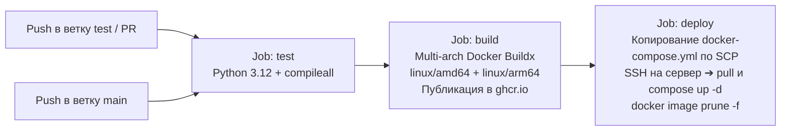

# 🎬 Shorts / TikTok / Reels Downloader Bot (shrt-tt-reels)

[](https://www.python.org/)
[](https://docs.aiogram.dev/)
[](https://www.docker.com/)
[](https://github.com/welcomeforalone/shrt-tt-reels/actions)
[](#-devsecops-и-архитектура-безопасности)
[](LICENSE)
[](README.md)

🌐 **Язык / Language:** [🇷🇺 Русский](README.ru.md) | [🇺🇸 English Documentation (README.md)](README.md)

---

**shrt-tt-reels** — высокопроизводительный, отказоустойчивый асинхронный Telegram-бот корпоративного уровня, предназначенный для загрузки, интеллектуального перекодирования и отправки медиаконтента из **TikTok** (HD-видео без водяных знаков и фото-карусели), **Instagram Reels** и **YouTube Shorts**.

Проект спроектирован по строгим стандартам **DevSecOps**: многоуровневая фильтрация SSRF и защита от DNS Rebinding, автоматизированный обход анти-бот систем (локальный генератор Proof-of-Origin токенов YouTube в связке с SOCKS5-туннелированием через Cloudflare WARP), асинхронное ограничение конкурентных задач, безопасный рейт-лимитер с защитой от утечек памяти, умная компрессия видео через FFmpeg и полная двуязычная локализация (RU/EN).

---

## 📑 Содержание

- [Архитектурный обзор](#-архитектурный-обзор)
- [Ключевые возможности](#-ключевые-возможности)
  - [Обработка TikTok](#1-обработка-tiktok-botbackendstiktokpy)
  - [Обработка Instagram Reels](#2-обработка-instagram-reels-botbackendsinstagrampy)
  - [Обработка YouTube Shorts](#3-обработка-youtube-shorts-botbackendsyoutubepy)
  - [Умное сжатие видео](#4-умное-сжатие-видео-botutilspy)
  - [Двуязычная локализация (i18n)](#5-двуязычная-локализация-i18n-boti18npy)
- [DevSecOps и архитектура безопасности](#-devsecops-и-архитектура-безопасности)
- [Быстрый старт (Docker Compose)](#-быстрый-старт-docker-compose)
- [Конфигурация (Environment Variables)](#-конфигурация-environment-variables)
- [CI/CD пайплайн](#-cicd-пайплайн)
- [Структура репозитория](#-структура-репозитория)
- [Лицензия](#-лицензия)

---

## 🏗️ Архитектурный обзор

Обработка запроса построена на базе `aiogram 3.x` и `asyncio`. До запуска загрузки запрос проходит защитный периметр, после чего маршрутизируется по паттерну «Цепочка ответственности» (Chain of Responsibility):

```mermaid
flowchart TD
    User([Пользователь Telegram]) -->|1. Отправляет ссылку| Bot[Контейнер Telegram-бота<br/>aiogram 3.x + asyncio]

    subgraph SecurityLayer ["1. Слой безопасности и ресурсов (bot/utils.py)"]
        SSRF["Фильтр SSRF и DNS Rebinding<br/>Схема + Blocklist + socket.getaddrinfo + ipaddress"]
        RateLimit["Rate Limiter скользящего окна<br/>5 запросов/мин на пользователя + очистка памяти GC"]
        Semaphores["Семафоры asyncio.Semaphore<br/>Загрузки: макс 3 | Компрессия: макс 2"]
    end

    Bot --> SSRF
    SSRF -->|Безопасный публичный URL| RateLimit
    SSRF -->|Запрещенный хост/IP/схема| RejectSSRF["Отклонение: unsafe_url"]
    RateLimit -->|Лимит не превышен| Semaphores
    RateLimit -->|Превышен лимит| RejectLimit["Отклонение: rate_limit"]

    subgraph RouterLayer ["2. Маршрутизатор платформ / Цепочка ответственности (bot/downloader.py)"]
        Semaphores --> Router{"Определение платформы<br/>(Regex-шаблоны)"}
        Router -->|TikTok URL| TikWM["API tikwm.com (bot/backends/tiktok.py)<br/>HD без водяных знаков / Фотоальбомы"]
        Router -->|Instagram URL| IGAPI["Хук публичного API (bot/backends/instagram.py)"]
        Router -->|YouTube / Fallback| YTDLPRouter["Движок yt-dlp (bot/backends/youtube.py)"]
        TikWM -.->|Fallback при сбое API (если не /photo/)| YTDLPRouter
        IGAPI -.->|Fallback при сбое API| YTDLPRouter
    end

    subgraph InfraLayer ["3. Анти-бот и сетевая инфраструктура (docker-compose.yml)"]
        YTDLPRouter --> CookieClone["Потокобезопасная изоляция cookies<br/>cookies.txt ➔ {uuid}_cookies.txt"]
        CookieClone --> POToken["Генератор PO-токенов (Proof-of-Origin)<br/>Сервис bgutil-pot (:4416) внутри bot_network"]
        POToken --> WARPProxy["Туннелирование исходящего трафика<br/>Cloudflare WARP (socks5://warp:1080)"]
        WARPProxy -.->|Сбой повторов с экспоненциальной задержкой| DirectConn["Прямое соединение без прокси (Fallback)"]
    end

    subgraph MediaLayer ["4. Обработка и отправка медиа (bot/handlers.py, bot/utils.py)"]
        TikWM -->|Фото-карусель| PhotoChunker["Разбивка фото-карусели<br/>Чанки по 10 фото для MediaGroupBuilder"]
        WARPProxy & DirectConn & TikWM -->|Видеофайл| SizeCheck{"Размер файла > 45 МБ?<br/>(MAX_VIDEO_SIZE_MB)"}
        SizeCheck -->|Нет (<= 45 МБ)| Dispatcher["Диспетчер отправки Telegram"]
        SizeCheck -->|Да (> 45 МБ)| FFmpeg["Транскодирование FFmpeg<br/>libx264, veryfast, crf 28, maxrate 2M<br/>Таймаут 180с и принудительный SIGKILL"]
        FFmpeg --> FinalCheck{"Размер после сжатия <= 50 МБ?"}
        FinalCheck -->|Да| Dispatcher
        FinalCheck -->|Нет| RejectSize["Ошибка: Видео превышает лимит Telegram 50 МБ"]
        PhotoChunker --> Dispatcher
    end

    Dispatcher -->|answer_video / answer_photo / answer_media_group| TelegramAPI["Telegram Cloud API"]
    TelegramAPI --> User
    Dispatcher --> Cleanup["Гарантированная очистка ресурсов<br/>Блоки finally удаляют временные видео, чанки фото и cookies"]
```

---

## ✨ Ключевые возможности

### 1. Обработка TikTok (`bot/backends/tiktok.py`)
- **Загрузка HD-видео без водяных знаков**: Запрос к `https://www.tikwm.com/api/` (`hd=1`) через оптимизированный пул соединений `httpx.AsyncClient` с пользовательскими заголовками современного браузера.
- **Поддержка фото-каруселей**: Распознавание массивов изображений (`images`) и их последовательная загрузка.
- **Группировка в альбомы Telegram**: Разбивка каруселей любого объема (включая альбомы из 35+ фото) на группы максимум по 10 снимков с помощью `MediaGroupBuilder` в строгом соответствии с лимитами Telegram API. Одиночные фотографии отправляются методом `answer_photo`.
- **Атомарный откат при сбоях**: При разрыве соединения во время загрузки альбома все частично записанные файлы (`_{index}.jpg`) немедленно удаляются из файловой системы в блоке перехвата исключений.
- **Защита yt-dlp от падений**: Если API `tikwm.com` вернуло ошибку, переход на запасной бэкенд `yt-dlp` блокируется для ссылок, содержащих `/photo/`, так как парсер yt-dlp аварийно завершается на фото-ссылках TikTok.

### 2. Обработка Instagram Reels (`bot/backends/instagram.py`)
- **Модульная цепочка обязанностей**: Реализован абстрагированный интерфейс `download_via_public_api`, позволяющий легко интегрировать публичные или приватные скрейперы Instagram.
- **Автоматический откат на yt-dlp**: При отсутствии внешнего API запрос передается в `yt-dlp`, туннелируемый через IP-пулы Cloudflare WARP.

### 3. Обработка YouTube Shorts (`bot/backends/youtube.py`)
- **Обход анти-бот проверок YouTube (PO Token)**: Интеграция плагина `bgutil-ytdlp-pot-provider` с локальным HTTP-демоном (`http://bgutil-pot:4416`), генерирующим валидные криптографические Proof-of-Origin токены посетителя.
- **Туннелирование через Cloudflare WARP**: Маршрутизация загрузок через внутренний SOCKS5-прокси (`socks5://warp:1080`), исключающая блокировки по IP-репутации хостинга.
- **Потокобезопасная изоляция cookies**: Файл `/home/botuser/app/cookies.txt` клонируется в индивидуальный файл для каждого процесса (`{base_path}_cookies.txt`). Это предотвращает гонки потоков (race conditions) при параллельной работе воркеров `yt-dlp`.
- **Экспоненциальная задержка и прямое соединение**: Механизм повторных попыток с экспоненциальным интервалом (`2 ** attempt` секунд). В случае исчерпания попыток через прокси выполняется контрольная попытка прямой загрузки без прокси.
- **Очистка артефактов**: Очистка по маске `{base_path}.*` гарантированно удаляет временные файлы (`.part`, `.ytdl`, `_cookies.txt`).

### 4. Умное сжатие видео (`bot/utils.py`)
- **Адаптивный контроль размера**: Сравнение размера скачанного ролика с порогом `MAX_VIDEO_SIZE_MB` (по умолчанию: 45 МБ). При превышении активируется FFmpeg:
  ```bash
  ffmpeg -y -i <input> -vcodec libx264 -preset veryfast -crf 28 -maxrate 2M -bufsize 4M -vf scale=-2:'min(1280,ih)' -stats -acodec copy <output>
  ```
  - Ограничение разрешения до 720p/1080p (`scale=-2:'min(1280,ih)'`) с сохранением соотношения сторон.
  - Жесткий потолок битрейта 2 Мбит/с с буфером 4 МБ гарантирует, что итоговый файл впишется в лимит Telegram (50 МБ).
  - Прямое копирование аудиодорожки (`-acodec copy`) для экономии процессорного времени.
- **Сторожевой таймер (Watchdog)**: Процесс обернут в `asyncio.wait_for(..., timeout=180)`. Если конвертация зависает дольше 3 минут, процесс немедленно уничтожается через `process.kill()`, а временные артефакты удаляются.

### 5. Двуязычная локализация (i18n) (`bot/i18n.py`)
- **Поддерживаемые языки**: Русский (`ru`) и английский (`en`).
- **Интерактивное управление**: Смена языка доступна командами `/lang`, `/language` или по нажатию инлайн-кнопок (`InlineKeyboardMarkup`) в стартовом сообщении `/start`.
- **Автоопределение**: Анализируется поле `user.language_code`. Пользователям с кодами `ru`, `be` (белорусский) и `uk` (украинский) автоматически назначается русский интерфейс.
- **Атомарное сохранение**: Языковые предпочтения пользователей сохраняются в файл `data/user_langs.json` через временный файл (`data/user_langs.json.tmp` ➔ `os.replace`), что предотвращает повреждение JSON при аварийной остановке контейнера.
- Английская версия документации доступна в [README.md](README.md).

---

## 🛡️ DevSecOps и архитектура безопасности

В проекте реализованы жесткие меры противодействия сетевым атакам и исчерпанию ресурсов:

| Вектор безопасности | Реализация в кодовой базе | Файл |
| :--- | :--- | :--- |
| **Защита от SSRF** | Разрешены только протоколы `http` и `https`. Проверяется черный список служебных имен контейнеров (`localhost`, `warp`, `warp_proxy`, `bgutil-pot`, `bgutil_pot`, `bot`, `tiktok_downloader_bot`) и внутренних доменных зон (`.local`, `.internal`, `.localhost`, `.lan`). | `bot/utils.py` |
| **Защита от DNS Rebinding** | Выполняется резолв адреса через `socket.getaddrinfo(hostname, None)`. Каждый полученный IP-адрес проверяется через модуль `ipaddress`. Блокируются диапазоны RFC 1918 (приватные), loopback (`127.0.0.0/8`), link-local (`169.254.0.0/16`), мультикаст и зарезервированные адреса. | `bot/utils.py` |
| **Изоляция сети Docker** | Контейнеры `warp` (прокси) и `bgutil-pot` **не имеют проброшенных портов на хост**. Взаимодействие происходит внутри закрытой bridge-сети `bot_network`. | `docker-compose.yml` |
| **Минимальные привилегии** | Контейнер с ботом работает от непривилегированного пользователя `botuser` (UID 1000) без доступа к sudo. | `Dockerfile` |
| **Ограничение конкурентности** | Использование `asyncio.Semaphore`: жесткое ограничение параллельных загрузок (`MAX_CONCURRENT_DOWNLOADS=3`) и ресурсоемких процессов компрессии (`MAX_CONCURRENT_COMPRESSIONS=2`). | `bot/utils.py` |
| **Защита памяти рейт-лимитера** | Алгоритм скользящего окна (5 запросов в минуту). Удаляются устаревшие временные метки. При превышении словарем размера в 500 записей запускается принудительная сборка мусора неактивных пользователей. | `bot/utils.py` |
| **Защита от переполнения диска** | Параметр `'max_filesize': 150MB` в `yt-dlp` предотвращает скачивание многочасовых трансляций. Все промежуточные файлы удаляются в блоках `finally`. | `bot/backends/youtube.py` |
| **Корректное завершение (Graceful Shutdown)** | При получении сигналов `SIGINT`/`SIGTERM` вызываются `bot.session.close()` и `close_http_client()`, корректно освобождая системные ресурсы. | `bot/main.py` |

---

## 🚀 Быстрый старт (Docker Compose)

### Системные требования
- Сервер под управлением Linux, macOS или Windows с установленными **Docker** и **Docker Compose v2+**.
- Токен Telegram-бота, полученный у [@BotFather](https://t.me/BotFather).

### Пошаговая установка

#### 1. Клонирование репозитория
```bash
git clone https://github.com/welcomeforalone/shrt-tt-reels.git
cd shrt-tt-reels
```

#### 2. Создание файла конфигурации
Скопируйте шаблон переменных окружения:
```bash
cp .env.example .env
```
Откройте файл `.env` и вставьте ваш токен Telegram:
```ini
BOT_TOKEN=1234567890:AAH_your_telegram_bot_token_here
WARP_PROXY_URL=socks5://warp:1080
MAX_VIDEO_SIZE_MB=45
RATE_LIMIT_PER_MINUTE=5
MAX_CONCURRENT_DOWNLOADS=3
MAX_CONCURRENT_COMPRESSIONS=2
USER_LANGS_PATH=data/user_langs.json
```

#### 3. Подготовка файла cookies
Создайте пустой файл `cookies.txt`, чтобы предотвратить ошибку монтирования директории в Docker:
```bash
touch cookies.txt
```
> [!TIP]
> При частых блокировках со стороны YouTube экспортируйте cookies вашего браузера в формате Netscape и вставьте их содержимое в `cookies.txt`.

#### 4. Запуск контейнеров
Соберите образ и запустите инфраструктуру в фоновом режиме:
```bash
docker compose up -d --build
```

#### 5. Проверка журналов
Убедитесь в успешном старте бота и связанных служб:
```bash
docker compose logs -f bot
```

---

## ⚙️ Конфигурация (Environment Variables)

Параметры считываются классом `Settings` из `bot/config.py` на базе `pydantic-settings`:

| Переменная | Тип | По умолчанию | Назначение |
| :--- | :---: | :---: | :--- |
| `BOT_TOKEN` | `str` | `""` (*Обязательно*) | Токен авторизации Telegram Bot API от `@BotFather`. |
| `WARP_PROXY_URL` | `str` | `socks5://warp:1080` | URL SOCKS5-прокси контейнера Cloudflare WARP. |
| `MAX_VIDEO_SIZE_MB` | `int` | `45` | Пороговый размер видеофайла в МБ, свыше которого запускается сжатие FFmpeg. |
| `RATE_LIMIT_PER_MINUTE` | `int` | `5` | Максимальное количество ссылок, принимаемых от одного пользователя в минуту. |
| `MAX_CONCURRENT_DOWNLOADS` | `int` | `3` | Максимальное количество одновременных сетевых загрузок (`asyncio.Semaphore`). |
| `MAX_CONCURRENT_COMPRESSIONS` | `int` | `2` | Максимальное число параллельных процессов транскодирования FFmpeg. |
| `USER_LANGS_PATH` | `str` | `data/user_langs.json` | Путь на диске для постоянного хранения языковых предпочтений пользователей. |

---

## 🔄 CI/CD пайплайн

В проекте настроен автоматический пайплайн сборки и доставки на базе GitHub Actions (`.github/workflows/deploy.yml`):



### Этапы работы пайплайна:
1. **Тестирование (`test`)**:
   - Срабатывает при пуше в ветки `main`, `test` и создании Pull Request в ветку `main`.
   - Разворачивает Python 3.12 с кэшированием pip.
   - Выполняет компиляцию байткода `python -m compileall bot` для выявления синтаксических ошибок и некорректных импортов.
2. **Сборка образов (`build`)**:
   - Выполняется строго при пуше в `main` после успешного прохождения шага `test`.
   - Инициализирует эмуляторы QEMU и движок Docker Buildx.
   - Собирает мультиплатформенный Docker-образ под архитектуры `linux/amd64` и `linux/arm64`.
   - Публикует образы с тегами `:latest` и `:${{ github.sha }}` в GitHub Container Registry (`ghcr.io/welcomeforalone/shrt-tt-reels`).
3. **Автоматический деплой (`deploy`)**:
   - Передает `docker-compose.yml` на целевой сервер через `appleboy/scp-action`.
   - Подключается по SSH (`appleboy/ssh-action`), авторизуется в `ghcr.io`, подтягивает свежий образ `docker compose pull bot`, перезапускает службы `docker compose up -d` и очищает старые слои командой `docker image prune -f`.
   - Очередь деплоя изолирована (`group: deploy`, `cancel-in-progress: false`), что исключает наложение деплоев друг на друга.

---

## 📂 Структура репозитория

```
shrt-tt-reels/
├── .github/
│   └── workflows/
│       └── deploy.yml          # Пайплайн GitHub Actions CI/CD
├── bot/
│   ├── backends/
│   │   ├── instagram.py        # Загрузчик Instagram и точка подключения внешних API
│   │   ├── tiktok.py           # Клиент API tikwm.com, парсер фотоальбомов и очистка
│   │   └── youtube.py          # Бэкенд yt-dlp, интеграция PO-токенов и изоляция cookies
│   ├── config.py               # Настройки приложения на базе Pydantic Settings
│   ├── downloader.py           # Маршрутизатор платформ (паттерн Chain of Responsibility)
│   ├── handlers.py             # Обработчики команд, сообщений и колбэков aiogram 3
│   ├── i18n.py                 # Двуязычная локализация и атомарная запись на диск
│   ├── main.py                 # Точка входа, цикл поллинга и корректное завершение
│   └── utils.py                # Защита от SSRF, семафоры, рейт-лимитер и сжатие FFmpeg
├── data/                       # Смонтированная директория для сохранения данных
│   └── user_langs.json         # Сохраненные языки пользователей
├── .dockerignore               # Исключения контекста сборки Docker
├── .env.example                # Шаблон конфигурационных переменных
├── .gitignore                  # Исключения системы контроля версий Git
├── cookies.txt                 # Файл cookies в формате Netscape для YouTube
├── docker-compose.yml          # Оркестрация стека (bot + warp + bgutil-pot)
├── Dockerfile                  # Защищенный образ контейнера с непривилегированным пользователем
├── README.md                   # Англоязычная документация
├── README.ru.md                # Русскоязычная документация (текущий файл)
└── requirements.txt            # Зависимости Python
```

---

## 📄 Лицензия

Проект распространяется под условиями открытой лицензии [MIT License](LICENSE).
